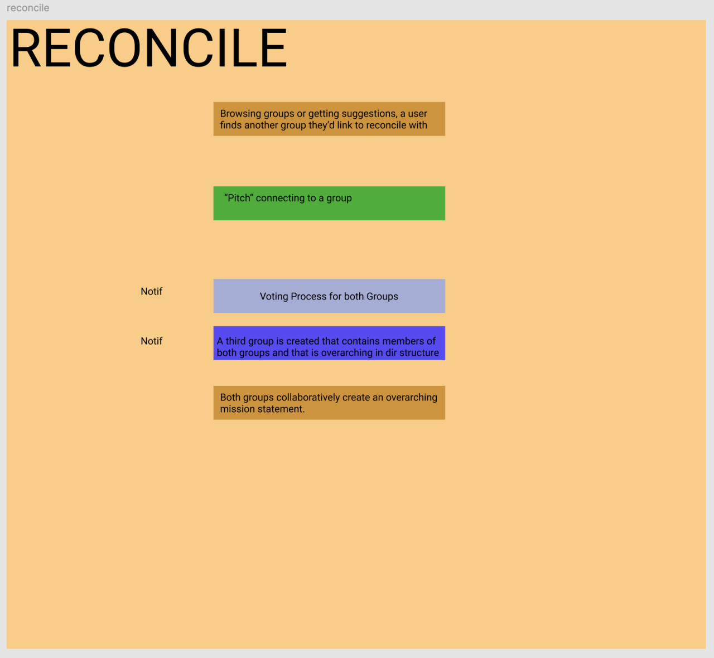

# Reconcile

**Reconcile is a platform for collaborative document editing that creates opportunities for organizations to become "strange bedfellows" and ally themselves toward whatever objectives they share.**

Think **GitHub pull requests + democratic voting + mission statements + a coalition graph**.

Groups often stall in endless discussion that never consolidates. Manifestos written by one charismatic person turn out brittle, and movements splinter over wording. Reconcile makes it easier for people with differences to **find and keep the overlap where they can act together**. Agreement doesn't have to be all or nothing. Two organizations can disagree about 95% of reality and still collaborate on the other 5%.



## How it works

- **Co-Creators** (users) write personal **Mission Statements** and join **Organizations**, such as Discord servers, social movements, or Facebook groups.
- Organizations maintain living **Documents** through a democratic, Git-like process:
  1. **View**: open a document
  2. **Proposal**: propose a change to an **Atom** (a section, clause, or value statement), with a title and justification
  3. **Discuss**: debate in a temporary channel, thread, or call
  4. **Vote**: opted-in members score the change from 0 to 4. It passes on a consent floor: an average of at least 2 with fewer than 10% strongly opposed
  5. **Update**: the change is merged, or it isn't
- Organizations can **Reconcile** with each other through the same View → Proposal → Discuss → Vote cycle, with both groups voting. Together they form a **Coalition** that has its own jointly written mission statement.
- **Members** (followers) get notified about new and updated documents, **Dispatches**, and votes. That turns finished documents into calls to action: meetups, voting strategy, outreach.

The result is a map of reconcilable ontologies. Each of us agrees with everyone else about *something*, and we can focus our effort on what we share.

## Safety first

A tool that maps people's values and affiliations can be turned against them. Hostile states, extremists, data brokers, and harassers all benefit from lists. Reconcile treats **defending against weaponization** as a core requirement, so it is **local-first**. Your groups, documents, and votes live on members' devices, not in a central database that could be breached or subpoenaed. You find new groups through people you already share a group with, not through a searchable directory of everyone. See [ADR-0001](docs/adr/0001-local-first-trust-model.md).

## Project status

**Early stage.** The product concept is documented, the first architecture decisions are recorded in [`docs/adr/`](docs/adr/README.md), and this repo is a freshly scaffolded Python project with quality gates in place. There's no application code yet.

Planned phases (see the [roadmap](docs/plan/14_Roadmap_Open_Questions.md)):

| Phase | Focus |
|-------|-------|
| 0 | Finalize definitions, ethics, and privacy principles |
| 1 | Single-Organization MVP: onboarding, documents, proposal → vote → update, notifications |
| 2 | Coalition MVP: discovery, reconciliation proposals, dual voting, coalition documents |
| 3 | Outer loop: the Member experience, scheduled Dispatches, calls to action |

## Documentation

- [Who Reconcile is for](docs/use-cases.md)
- [Architecture decisions](docs/adr/README.md) (ADRs 0001–0040)
- [Phase 1 spec](docs/spec/phase-1-spec.md)

The original product definition lives in `docs/plan/`, which is kept local and isn't in the repository. Suggested reading order:

1. [What is Reconcile?](docs/plan/02_What_Is_Reconcile.md)
2. [Core entities](docs/plan/03_Core_Entities.md)
3. [Document editing workflow](docs/plan/04_Workflows_Document_Editing.md) and [voting and governance](docs/plan/07_Voting_and_Governance.md)
4. [Reconciling groups into coalitions](docs/plan/05_Workflows_Reconciling_Groups.md)
5. [Security, privacy, and threat model](docs/plan/12_Security_Privacy_Threat_Model.md)
6. Everything else: onboarding, notifications, UI/UX, philosophy, positioning, and the pitch deck

## Development

Requires Python 3 and pre-commit.

```bash
python -m venv .venv
source .venv/bin/activate
pip install -r requirements.txt -r requirements-dev.txt
pre-commit install
./scripts/check-all.sh
```

### Quality gates

| Command | Purpose |
|---------|---------|
| `./scripts/check-all.sh` | Every check; must pass before each commit |
| `./scripts/test.sh` | pytest with coverage (≥90%) |
| `./scripts/lint.sh` / `./scripts/typecheck.sh` | ruff and mypy (strict) |
| `./scripts/format.sh` | Auto-format |
| `./scripts/security.sh` | bandit and pip-audit |
| `./scripts/complexity.sh` | radon/xenon (cyclomatic complexity ≤10) |
| `./scripts/mutation.sh` | mutmut (≥80% mutation score) |

Development follows TDD with the "Stay Green" workflow. Contributor and AI-agent conventions are in [`CLAUDE.md`](CLAUDE.md) and [`.claude/docs/`](.claude/docs/).

## License

Source-available: public to read and audit, not licensed for modification or redistribution. The exact license text is pending legal review, and the repo isn't published yet ([ADR-0024](docs/adr/0024-source-available-license.md)).

---

Scaffolded with [Start Green Stay Green](https://github.com/Geoffe-Ga/start_green_stay_green).
