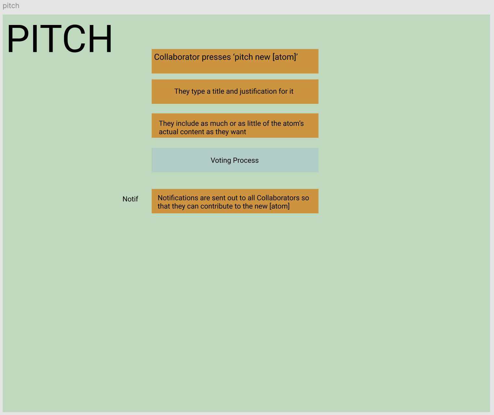
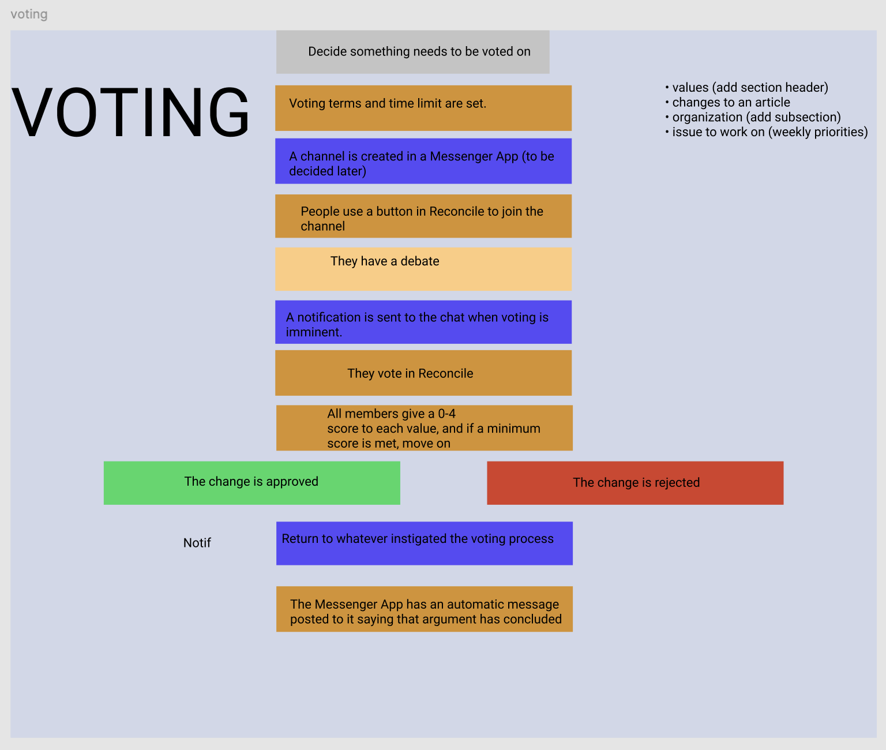
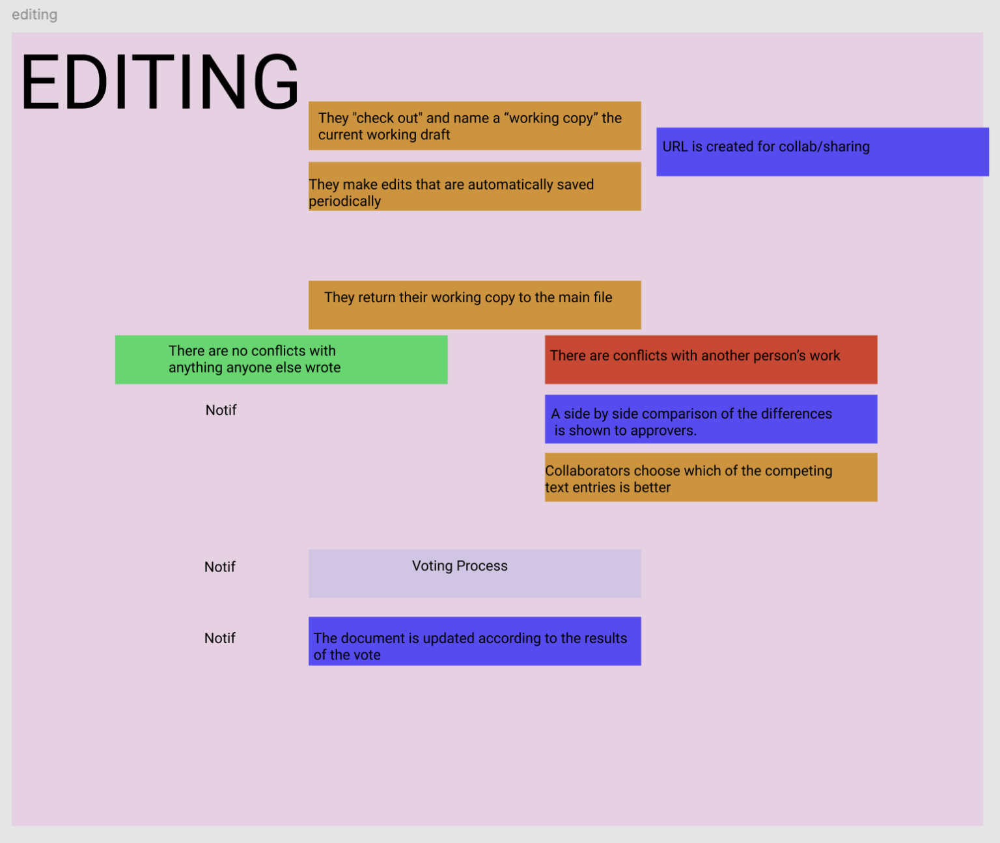

# Workflow: Document Editing (View → Proposal → Discuss → Vote → Update)

This is the core loop described in the one-pager and expanded in the visual slides.

## 1) View
A Collaborator accesses a document in an Organization they belong to.

The one-pager analogizes this to opening a file in GitHub’s editor view.

## 2) Proposal
A Collaborator proposes changes by “proposing” a new Atom (or a change to an existing Atom).

From the “PITCH” slide:

- Collaborator presses “propose new [atom]”
- They type a title and justification
- They include as much or as little of the atom’s actual content as they want
- Voting process happens
- Notifications are sent so other collaborators can contribute

(See the slide image for the original phrasing.)

## 3) Discuss
Discussion is explicitly envisioned as flexible and multi-channel.

The one-pager lists examples:
- a temporary channel,
- a thread,
- voice/video call,
- etc.

The “VOTING” slide implies there may be a dedicated chat channel created for debates and that people can join it via a button inside Reconcile.

## 4) Vote
A subset (or all) of the Organization’s opted-in members vote on the proposed change.

The vote can be time-limited and structured (details in 07_Voting_and_Governance.md).

## 5) Update
If approved, the atom is updated (or added). If rejected, the main document remains unchanged.

A key “Git-ish” nuance: the canonical document is not simply the last edit someone typed; it is the last edit that survived governance.

## The “Working Copy” editing model

The “EDITING” slide adds an intermediate drafting layer:

- A collaborator “checks out” and names a working copy of the current draft
- They make edits that are automatically saved periodically
- A URL is created for collaboration/sharing
- They “return” the working copy to the main file

Then:

- If there are no conflicts, it proceeds cleanly
- If there are conflicts:
  - a side-by-side comparison is shown to approvers,
  - collaborators choose which competing text is better

Then:

- voting process
- document updated according to results of the vote

## Why this workflow matters (conceptually)

This workflow is trying to solve a common group problem:

- Unilateral edits feel illegitimate.
- Endless discussion without convergence feels demoralizing.
- “Consensus” is often fake (quiet dissent, social pressure, attrition).

Reconcile’s loop tries to create:
- legibility (you can see what changed and why),
- boundedness (discussion and voting happen in explicit windows),
- and institutional memory (the living document becomes a history of resolved debates).
