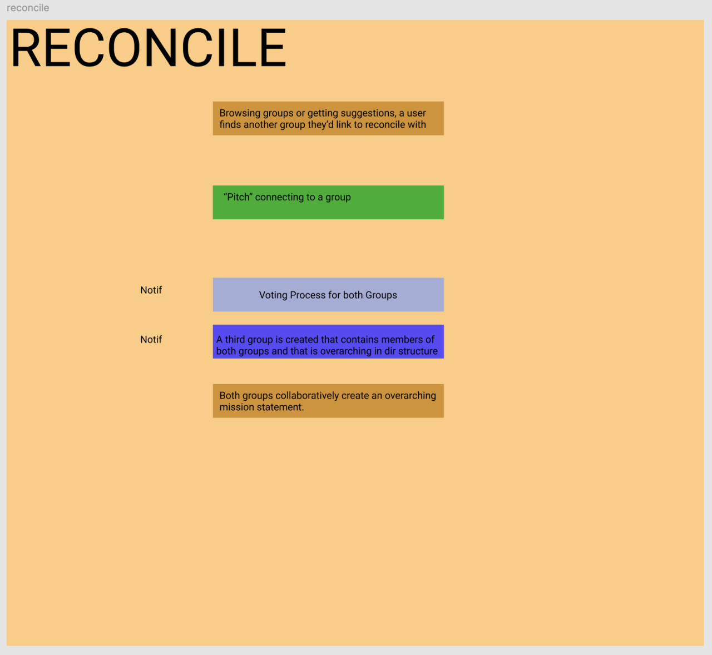

# Workflow: Reconciling Organizations into Coalitions

Reconcile has a second-order loop: not only do people reconcile text inside a group, groups can reconcile with each other.

This is the “strange bedfellows” mechanic.

## High-level concept

Organizations can “Reconcile” with each other to create umbrella entities called Coalitions.

A Coalition:
- contains members of both organizations (or at least a defined overlap of members),
- and holds an overarching mission statement representing the intersection of the participating groups.

The key constraint: this is not merger-by-assimilation. It’s overlap formalization.

## The Reconcile flow (from the slides)

The “RECONCILE” slide shows:

- Browsing groups or getting suggestions, a user finds another group they’d like to reconcile with
- They “Proposal” connecting to a group
- Voting process for both groups
- A third group is created that contains members of both groups and is overarching in structure
- Both groups collaboratively create an overarching mission statement

Notifications (“Notif”) appear on the slide as a key part of moving people through the process.

## Relationship to document editing

The one-pager explicitly says this reconciliation process follows a very similar rhythm to document editing:

- View
- Proposal
- Discuss
- Vote
- Reconcile

In other words: “coalition formation” is treated as a governed change, not a casual “follow” action.

## Implications

This model implies a few important things about the product’s worldview:

- Coalitions are not merely social links; they are entities with governance and a text-spine.
- Reconciliation is treated as something that requires consent from both sides (both groups vote).
- The output is not just connection—it’s a *new shared artifact* (the coalition mission statement).

## The weirdly mystical layer (without making stuff up)

The phrase “map of reconcilable ontologies” is a poetic way of saying:

- you can model which groups can collaborate,
- on which topics,
- and how stable that collaboration is over time.

Coalitions become “bridges” in the network: visible proof that two different frames of reality can overlap in practice.
