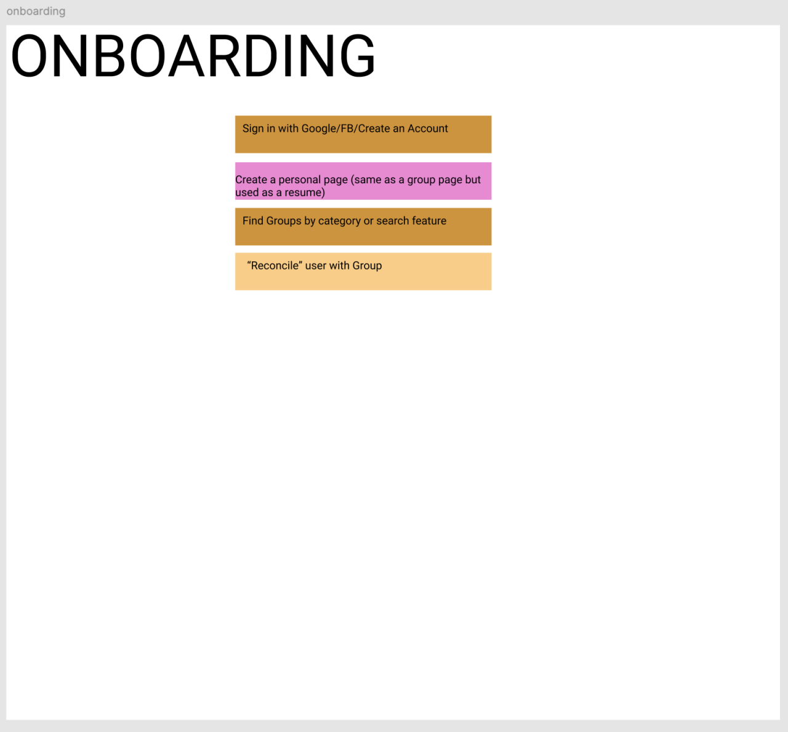
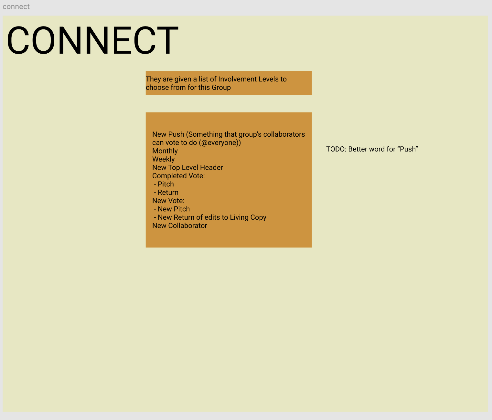

# Onboarding, Connection, and Involvement Levels

The visual slides include a set of steps meant to describe how a new person becomes a participant.

## Onboarding (from the slide)

The “ONBOARDING” slide lists:

- Sign in with Google/FB/Create an Account
- Create a personal page (same as a group page but used as a resume)
- Find Groups by category or search feature
- “Reconcile” user with Group

### Notes on meaning

- The “personal page as resume” implies reputational signaling:
  a person’s values, commitments, contributions, and affiliations are legible.
- “Reconcile user with Group” frames joining as more than clicking “join”:
  it suggests some form of mutual fit / explicit alignment step.

## Connect (from the slide)

The “CONNECT” slide adds a missing piece: **involvement levels**.

It says:

- “They are given a list of Involvement Levels to choose from for this Group”

And it contains a list of “New Push” notification types that a group’s collaborators can vote to do (like @everyone):
- Monthly
- Weekly
- New Top Level Header
- Completed Vote (Proposal / Return)
- New Vote (New Proposal / New Return of edits to Living Copy)
- New Collaborator

It also includes: “TODO: Better word for ‘Push’.”

### Why involvement levels matter

If you’re building for real humans with jobs, kids, and nervous systems, you need a “participation gradient.”

Involvement levels allow:
- the deeply engaged to govern and co-author,
- the moderately engaged to vote occasionally,
- and the lightly engaged to just receive updates and show up when asked.

This also matters for safety and consent:
- “opted in to participate” is explicitly mentioned in the one-pager regarding voting.
