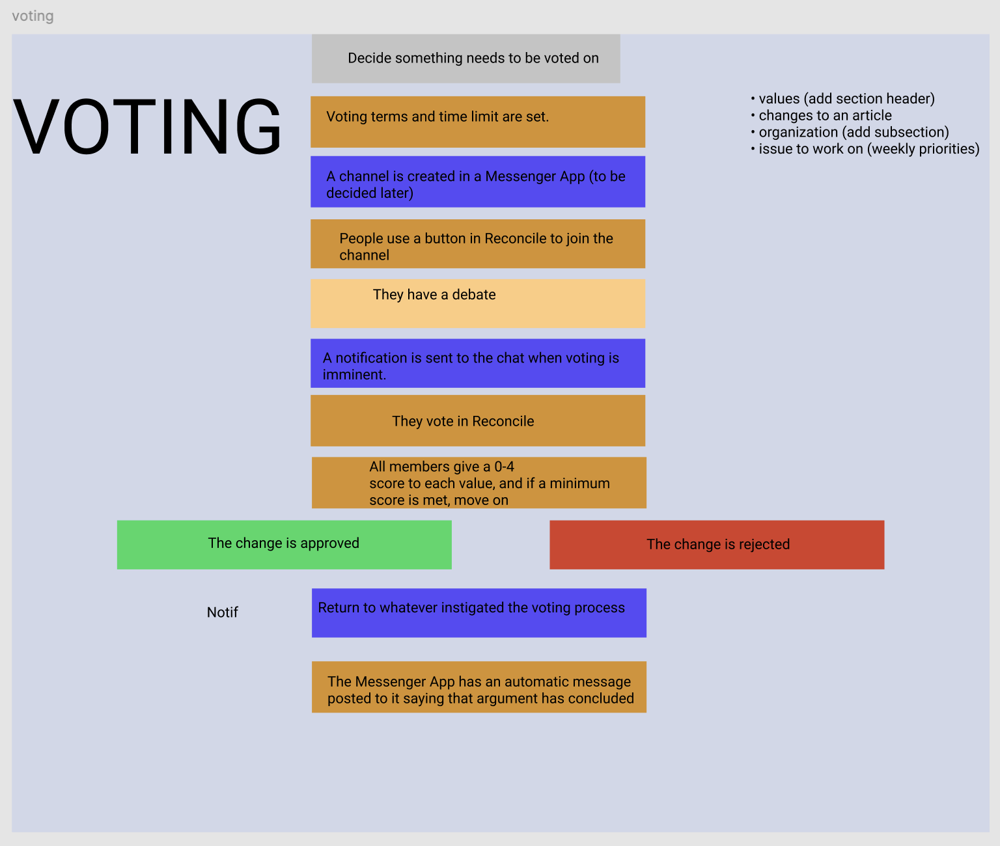

# Voting and Governance (What gets decided, how, and why)

Voting is the mechanism that turns collaborative editing from “a bunch of opinions” into “a living canonical document.”

## What might be voted on?

The “VOTING” slide lists example vote topics:

- values (add section header)
- changes to an article
- organization (add subsection)
- issue to work on (weekly priorities)

So: voting is not only for line edits; it can govern structure and priorities too.

## Voting flow (from the slide)

The slide describes a sequence:

1. Decide something needs to be voted on
2. Voting terms and time limit are set
3. A channel is created in a Messenger App (to be decided later)
4. People use a button in Reconcile to join the channel
5. They have a debate
6. A notification is sent to the chat when voting is imminent
7. They vote in Reconcile
8. All members give a 0–4 score to each value, and if a minimum score is met, move on
9. The change is approved OR rejected
10. Return to whatever instigated the voting process
11. The Messenger App posts an automatic message saying the argument has concluded

## The 0–4 scoring idea

A 0–4 score suggests something like:
- 0: strongly opposed
- 1: opposed
- 2: neutral / mixed
- 3: supportive
- 4: strongly supportive

The slide also implies:
- there is a minimum threshold for acceptance.

This is interesting because it’s not purely “majority wins.”
It hints at a “minimum consent” or “minimum enthusiasm” style threshold, which can reduce tyranny-of-the-majority dynamics in values statements.

(Exact semantics are not fully specified yet; treat this as defined intent, not finalized policy.)

## Governance scope

From the one-pager:
- Voting applies within Organizations,
- and also within Coalitions (especially for reconciliation and coalition documents).

“Co-Creators” are followers receiving notifications, but governance appears to be primarily for Collaborators / opted-in members.

## Why this matters

A governance model is not just process; it becomes culture.

Reconcile’s governance intent is trying to:
- make decisions legible,
- bound discourse,
- preserve institutional memory,
- and keep collaboration from devolving into either authoritarianism or infinite debate.

The shadow side is equally important:
- voting can be gamed,
- factions can capture processes,
- participation can be skewed by who has time and social power.

Those risks are addressed more directly in the security / threat-model doc.
