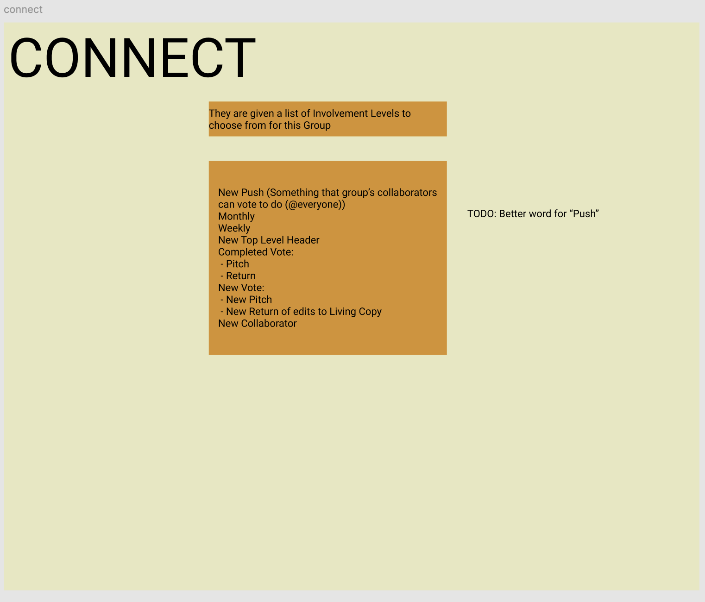

# Notifications, Pushes, and the Outer Loop (Co-Creators)

Reconcile has an “inner loop” (collaborators editing and voting) and an “outer loop” (followers receiving updates and being mobilized).

Notifications are the connective tissue.

## Who gets notified?

From the one-pager:
- Co-Creators (followers) of Collaborators, Organizations, and Coalitions receive notifications when those entities publish new or updated documents.

From the workflow slides:
- Collaborators also receive notifications when new atoms are proposed, votes are happening, and documents are updated.

So notifications span both:
- distribution (publish/update),
- and coordination (participate/decide).

## Notification types (explicitly listed)

From the one-pager:
- New Documents
- Updates to Documents
- Pushes
- Votes (Organizations and Coalitions only)

From the “CONNECT” slide’s “New Push” list:
- Monthly
- Weekly
- New Top Level Header
- Completed Vote:
  - Proposal
  - Return
- New Vote:
  - New Proposal
  - New Return of edits to Living Copy
- New Collaborator

## Pushes (working term)

A “Push” is described as:
- a notification instigated by a Collaborator for their personal documents, OR
- a notification instigated by a Proposal in a larger entity (to be voted on).

The slide explicitly says: “TODO: Better word for ‘Push’.”

This is useful because “push” is both:
- a technical term (push notifications),
- and a social term (pushing people).

Renaming it later could clarify intent: e.g., “Call,” “Signal,” “Ping,” “Summons,” “Broadcast,” “Pulse,” etc.
(That naming decision is open.)

## The messenger-app bridge

Voting and debate appear to involve a messenger app:
- a channel is created there,
- people join via a button in Reconcile,
- debate happens,
- then the vote happens back in Reconcile,
- and the messenger channel gets an auto “argument concluded” message.

This implies an important product boundary:
Reconcile is not trying to replace existing social spaces; it’s trying to add a structured decision spine.

## Why the outer loop is essential

Many civic tools die because:
- the people most involved burn out,
- and the people less involved never get activated at the right moments.

Co-Creators and notifications create:
- an audience for the evolving “living documents,”
- and a way to mobilize support for actions outside the platform.
