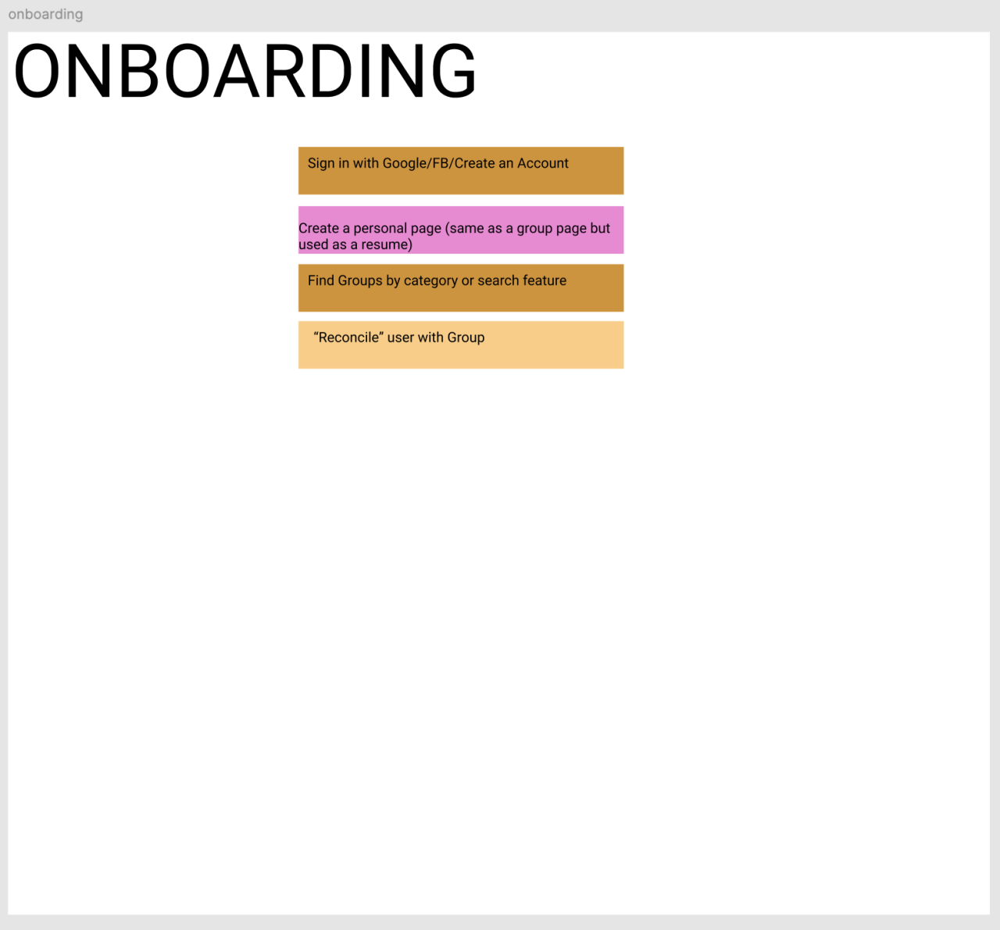
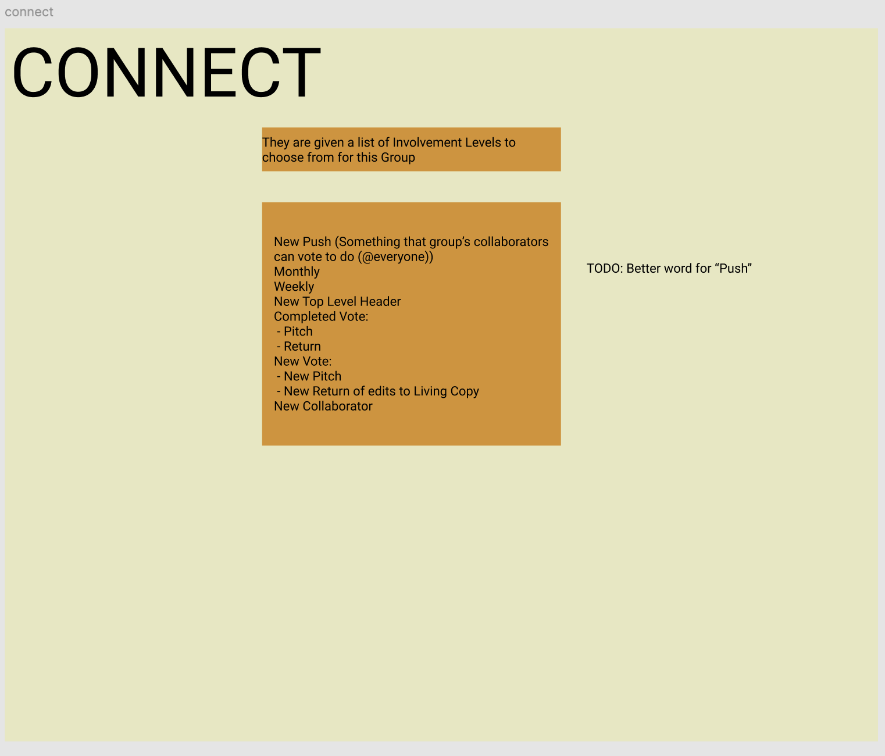
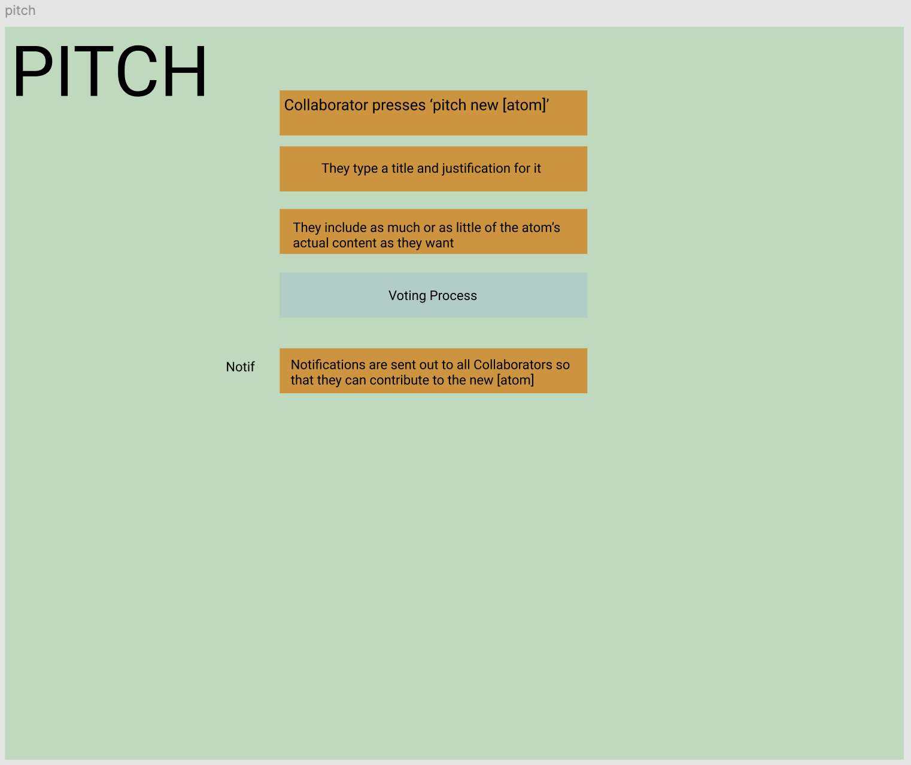
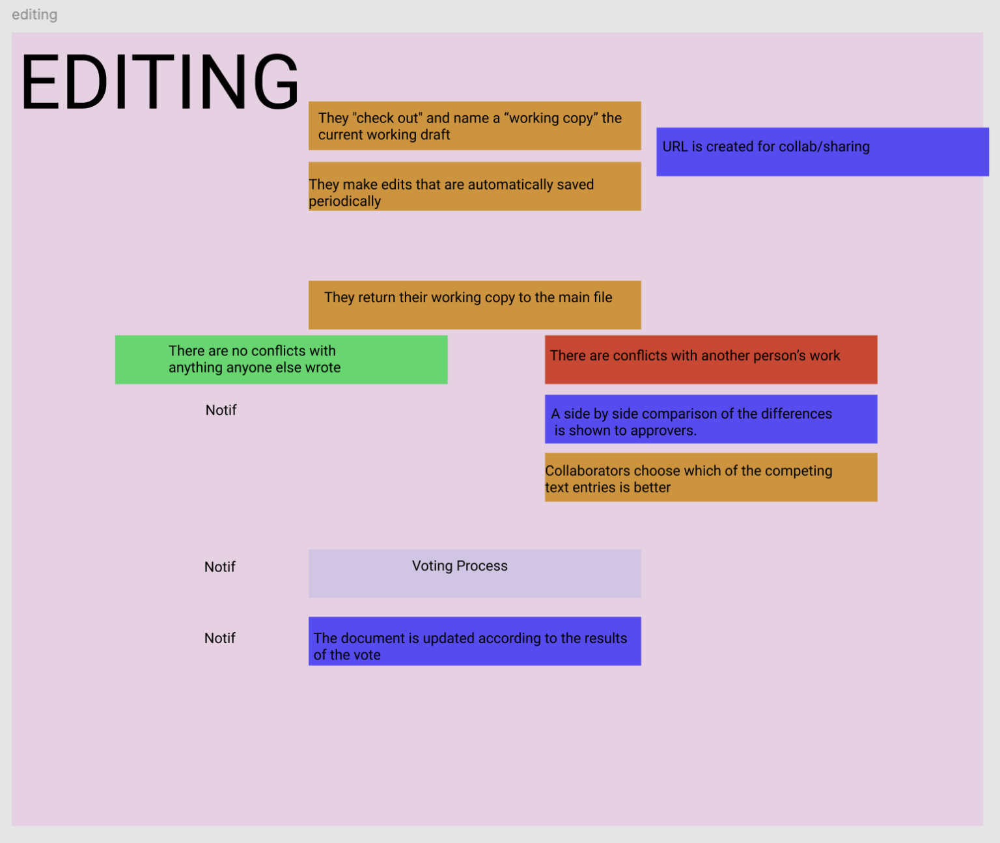
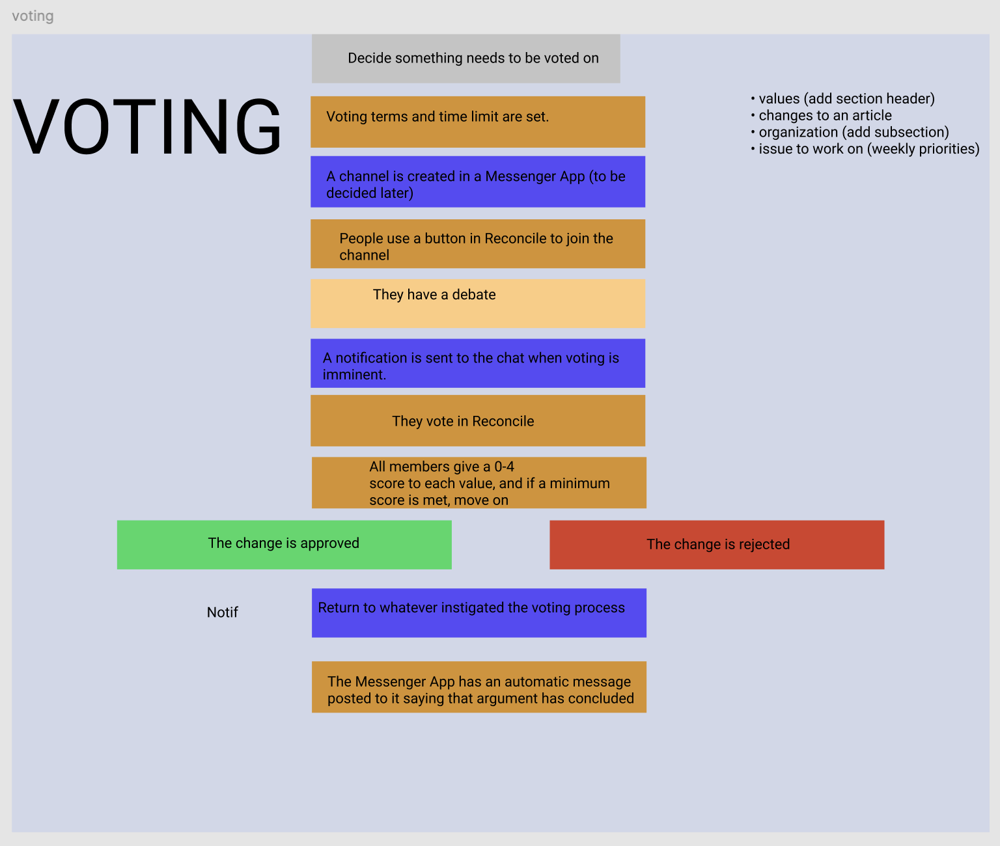
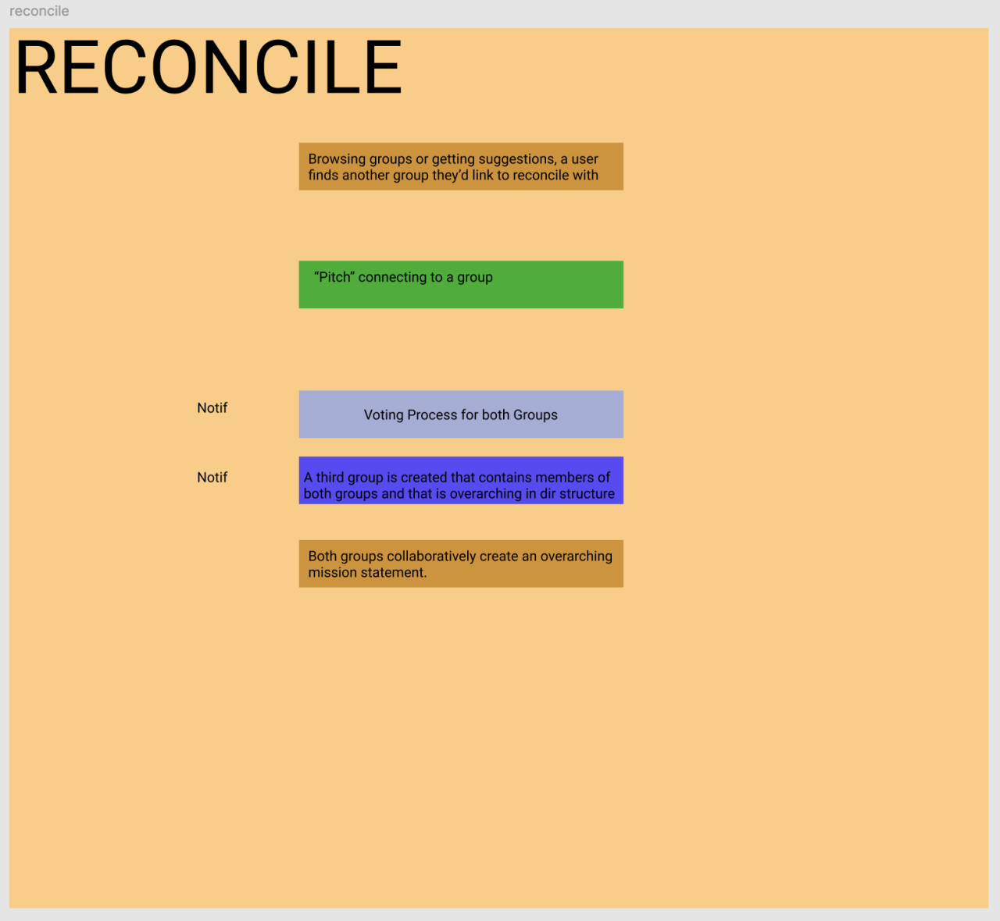

# UI/UX: Conceptual Screens and Journeys (from the diagrams)

This doc collects the slides/diagrams into a single “how would this feel?” narrative, without locking in a specific app architecture.

## The New Collaborator Journey (macro view)

One diagram titled “New Collaborator Journey” (note: it uses an earlier name, “Concillience”) describes a full arc:

- Future collaborators:
  - need to agree on what they stand for
  - decide they need a mission statement
  - don’t want some leader to make it unilaterally
- They decide to use the platform to do it collectively
- They move through onboarding and connection (joining or creating a group/cause/project)
- They propose section headers
- Editing process
- A notification is sent when the document is complete to anyone who subscribes
- Action is taken outside the platform to further goals of the movement

*(The "New Collaborator Journey" diagram isn't in `assets/`.)*

This diagram is important because it frames Reconcile as:
- a means to produce a shared artifact (a mission statement),
- which then drives real-world action.

## Screen / flow: Onboarding

Onboarding slide steps:
- sign in,
- create a personal page,
- find groups,
- reconcile user with group.

## Screen / flow: Connect

Connect slide introduces:
- involvement levels,
- and the taxonomy of pushes/notifications.

## Screen / flow: Proposal

Proposal slide describes:
- creating a proposal with title + justification,
- optionally including content,
- triggering voting,
- notifying collaborators.

## Screen / flow: Editing

Editing slide describes:
- check out working copy,
- autosave edits,
- shareable URL,
- return to main file,
- handle conflicts with side-by-side comparison,
- vote,
- update document.

## Screen / flow: Voting

Voting slide describes:
- time-limited voting terms,
- debate in messenger channel,
- “vote imminent” alerts,
- voting in Reconcile,
- 0–4 scoring system with minimum threshold,
- approved/rejected branch,
- and an auto “argument concluded” message in the messenger app.

## Screen / flow: Reconcile (group-to-group)

Reconcile slide describes:
- discovering other groups,
- proposing connection,
- both groups voting,
- creating a third umbrella group,
- and writing the overarching mission statement.

## UX principles implied (not yet “decided,” but strongly suggested)

From these flows, Reconcile seems to want:

- A clear separation between:
  - discussion space,
  - and canonical decision space.
- A user experience that makes governance feel:
  - bounded,
  - comprehensible,
  - and not like endless doomscroll discourse.
- Participation gradients (involvement levels).
- A bias toward “turning debate into text,” i.e., the output is a revised atom, not just chat logs.
