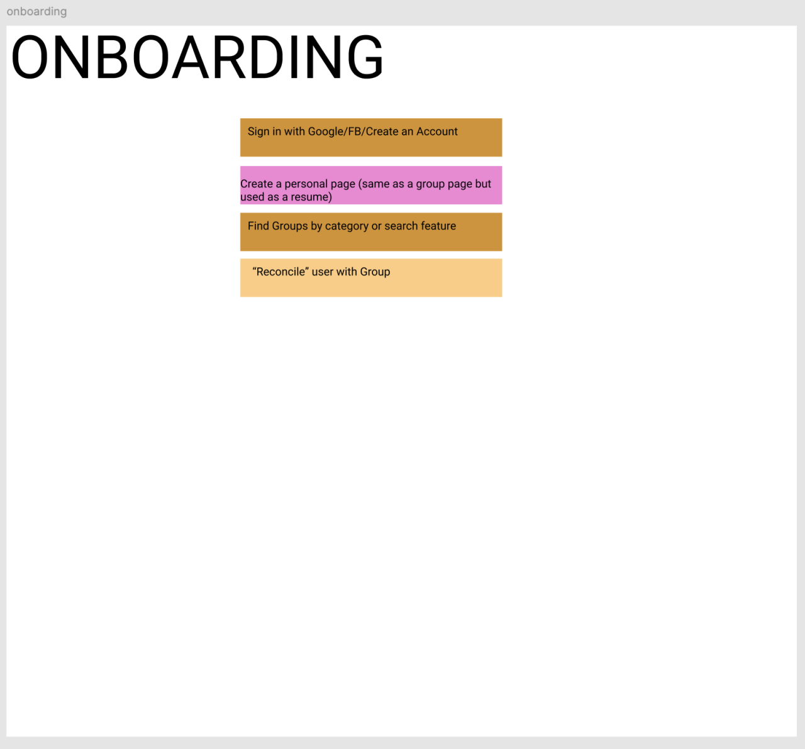
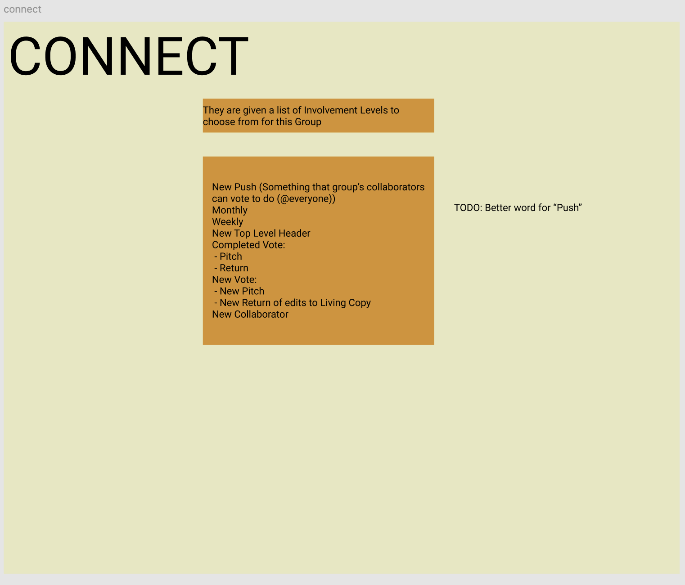
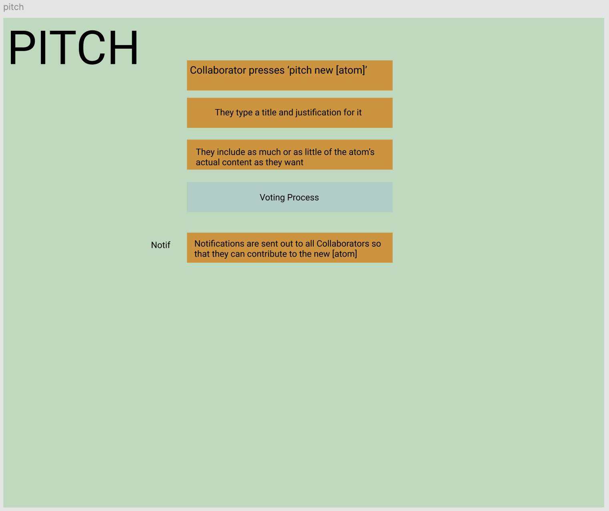
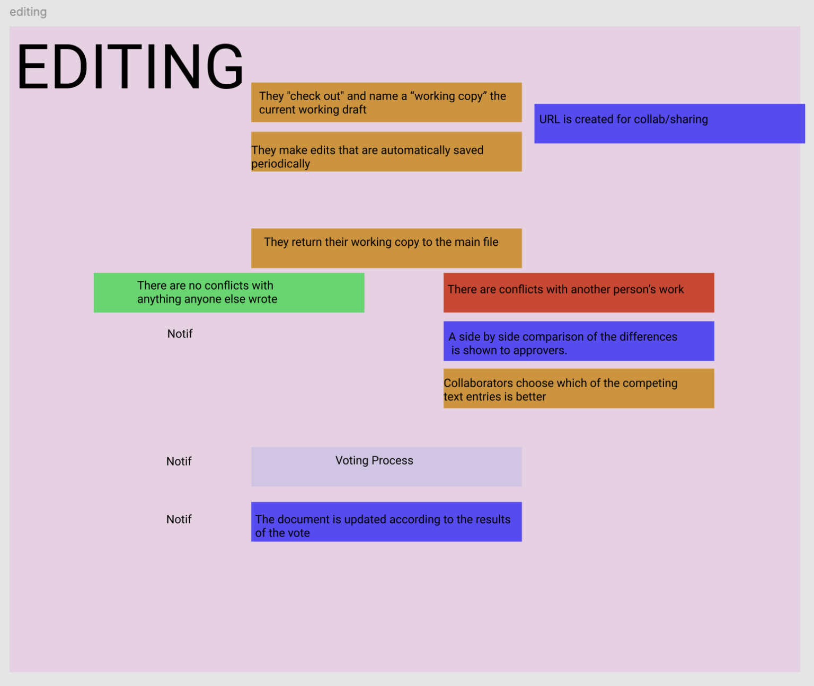
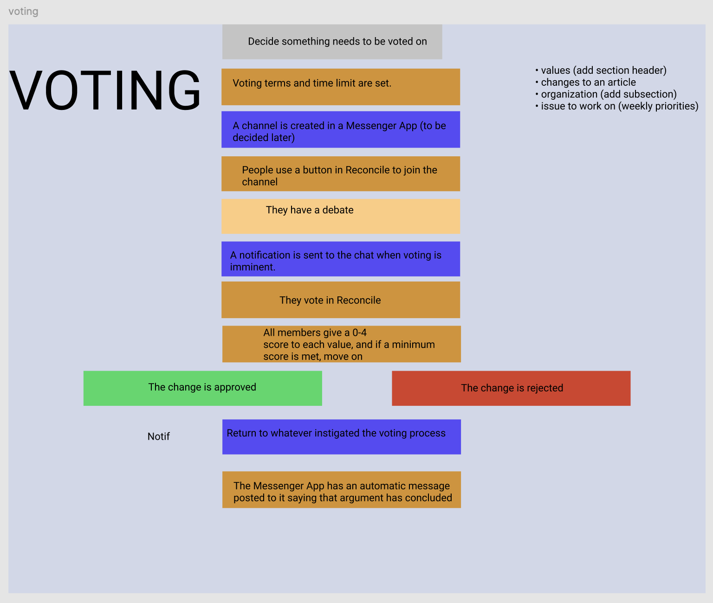
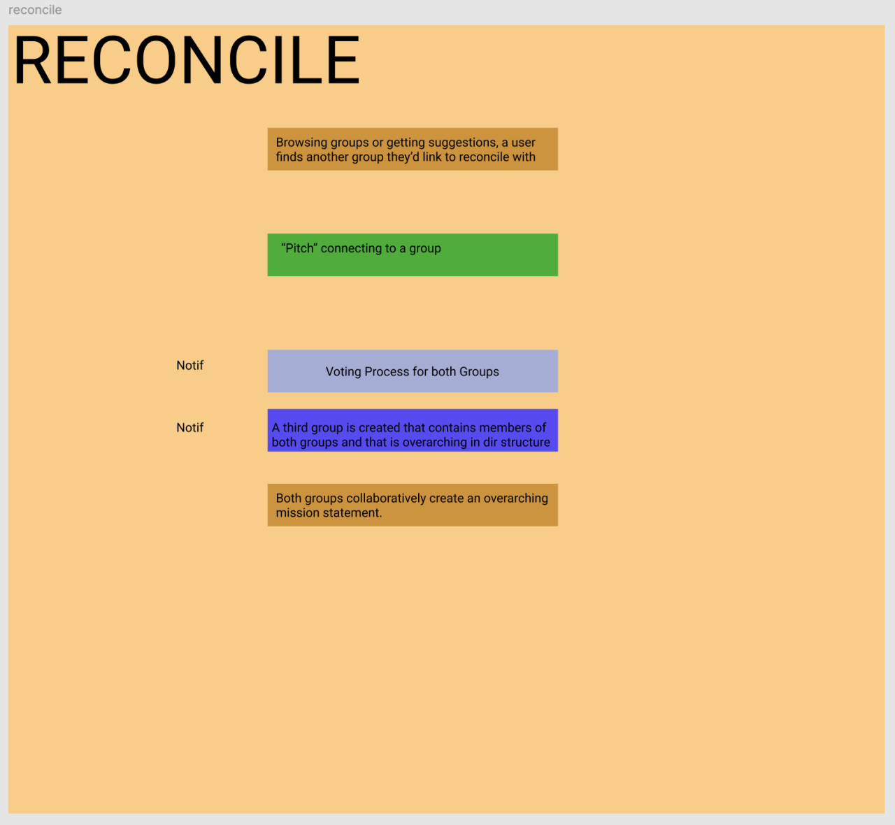

# Reconcile Pitch Deck (Reconstructed from the project’s slides + one-pager)

This document reformats the existing pitch materials into a single readable narrative.
It is intentionally verbose and slide-by-slide, so that it preserves the “word count energy” of a pitch deck while also making the logic legible in plain text.

It does **not** attempt to persuade. It attempts to **reconstruct**.

---

## Slide 1: What is Reconcile?

**Core definition**

Reconcile is a platform for collaborative document editing that creates opportunities for organizations to become “strange bedfellows” and ally themselves toward whatever objectives they share.

**Key comparison**
- It resembles a democratic kind of open-source Git version control, applied to mission statements and shared documents.

**The founding “problem feeling” (implied)**
- Groups need shared language.
- Groups want legitimacy.
- Groups don’t want a single leader writing the sacred text unilaterally.

---

## Slide 2: The cast of characters (Collaborators and Co-Creators)

**Collaborators**
- Users who actively author and propose changes.
- Collaborators write personal Mission Statements.
- Collaborators join Organizations.

**Co-Creators**
- Followers/subscribers of Collaborators, Organizations, and Coalitions.
- They receive notifications when entities publish new or updated Documents.

This creates two concentric circles:
- an inner circle that governs and edits,
- an outer circle that learns and mobilizes.

---

## Slide 3: The basic editing loop (View → Proposal → Discuss → Vote → Update)

From the one-pager, the core document editing process is:

- **View**: Collaborator accesses a document in an organization.
- **Proposal**: Collaborator presses “Propose new Atom,” edits a section, proposes a change (like a pull request).
- **Discuss**: Debate in a temporary channel, a thread, voice/video call, etc.
- **Vote**: Opted-in members vote on the change.
- **Update**: The Atom is updated (or not).

This loop is the engine. Everything else is built around it.

---

## Slide 4: “New Collaborator Journey” (macro narrative)

This diagram (it uses an earlier name, “Concillience,” but the flow maps cleanly to Reconcile) describes the user’s arc.

*(The "New Collaborator Journey" diagram isn't in `assets/`.)*

**Narrative version**

A future collaborator (or group of collaborators) reaches a moment of friction:

- They need to agree on what they stand for.
- They decide they need a mission statement.
- They don’t want some leader to make it unilaterally.

So they decide to use the platform to do it collectively.

They move through onboarding and connection (joining or creating a group/cause/project).

They propose section headers (meaning: they scaffold the document structure together).

They go through the editing process.

When the document is “complete,” a notification is sent to anyone who subscribes.

Then action happens outside the platform to further the goals of the movement.

**Key product claim embedded in the diagram**
- Reconcile is not “the revolution.” It is a coordination organ that produces shared artifacts that enable action elsewhere.

---

## Slide 5: Onboarding

**Steps**

- Sign in with Google/FB/Create an Account
- Create a personal page (same as a group page but used as a resume)
- Find Groups by category or search feature
- “Reconcile” user with Group

**Interpretation**

- Your personal page is an identity / integrity surface.
- Finding groups is discovery.
- Reconciling with a group suggests explicit alignment, not casual membership.

---

## Slide 6: Connect (and involvement levels)

**Key addition**
- Users are given a list of **Involvement Levels** to choose from for a group.

This implies:
- not everyone is a constant contributor,
- and the system respects varying levels of capacity.

**Notification / “Push” list**

The slide lists examples of “New Push” events (something group collaborators can vote to do, like @everyone):

- Monthly
- Weekly
- New Top Level Header
- Completed Vote (Proposal / Return)
- New Vote (New Proposal / New Return of edits to Living Copy)
- New Collaborator

And: “TODO: Better word for ‘Push’.”

---

## Slide 7: Proposal (atoms as the unit of change)

**Proposal flow**

- Collaborator presses “propose new [atom]”
- They type a title and justification
- They include as much or as little of the atom’s content as they want
- Voting process happens
- Notifications go out to all collaborators so they can contribute

**Key implication**
- Proposals are governance objects, not just edits.
- The system is designed to make “why this change?” legible.

---

## Slide 8: Editing (working copy, autosave, conflicts)

**Drafting model**

- Collaborator “checks out” and names a “working copy”
- They make edits that are automatically saved periodically
- A URL is created for collaboration/sharing
- They return the working copy to the main file

**Conflict model**

Two branches:

- No conflicts with anything anyone else wrote → proceed
- Conflicts with another person’s work →
  - side-by-side comparison shown to approvers
  - collaborators choose which competing text entries are better

Then:

- voting process
- document updated according to results

**Key implication**
- Reconcile wants the ergonomics of collaborative drafting without losing the legitimacy of governed merging.

---

## Slide 9: Voting (debate bridge + scoring)

**Voting flow**

- Decide something needs to be voted on
- Voting terms and time limit are set
- A channel is created in a Messenger App (to be decided later)
- People use a button in Reconcile to join the channel
- They have a debate
- Notification sent to the chat when voting is imminent
- They vote in Reconcile

**Scoring mechanism**

- All members give a 0–4 score to each value
- If a minimum score is met, move on

**Outcomes**

- The change is approved OR rejected
- Return to whatever instigated the voting process
- Messenger app posts an automatic message saying the argument has concluded

**Vote topics listed on the slide**
- values (add section header)
- changes to an article
- organization (add subsection)
- issue to work on (weekly priorities)

---

## Slide 10: Reconcile (group-to-group coalition formation)

**Coalition formation flow**

- While browsing groups or getting suggestions, a user finds another group they’d like to reconcile with
- They propose connecting to the group
- Voting process for both groups
- A third group is created containing members of both groups, overarching in structure
- Both groups collaboratively create an overarching mission statement

**Key claim**
- Coalitions become a formal, governed “overlap object.”

---

## Slide 11: What the system is used for (blog-like + action)

From the one-pager:

- The document editing tech might be used for blog-like activities:
  - values and philosophy,
  - action roadmaps,
  - outreach campaigns,
  - and more.

- It can be “blasted” to all Co-Creators as a way to:
  - organize meet-ups,
  - disseminate voting strategy,
  - call for help organizing,
  - or whatever else.

**Key claim**
- Reconcile is a coordination layer that ends in real-world action, not just text.

---

## Slide 12: The philosophical capstone

Again from the one-pager:

> In this way we create a map of reconcilable ontologies and recognize that we each agree with every other person about something and regardless of our differences, we can focus our attention and willpower on collaborating on our shared values and objectives.

This is the “why” sentence:
- pluralism with overlap,
- practical bridging,
- action through scoped agreement.

---

## Slide 13: The shadow question (added by the project chat)

The pitch material itself is optimistic. The project chat added the necessary existential dread:

- Does this become a database of ideologies and associations?
- Does it become valuable to hostile actors?
- Does it need local-first / mesh-like properties to be safe?

Those questions are not answered in the pitch deck yet, but they are part of the project’s reality now.
(See 12_Security_Privacy_Threat_Model.md.)

---

## Appendix: The one-pager in full (verbatim)

> Reconcile is a platform for collaborative document editing that creates opportunities for organizations to become “strange bedfellows” and ally themselves toward whatever objectives they share.
> Collaborators (users) write their own personal Mission Statements.
> They join Organizations and collaboratively create joint Mission Statements via a model for document editing resembling a democratic kind of open source Git version control.
> Organizations Reconcile into umbrella entities known as Coalitions.
> Co-Creators (followers) of Collaborators, Organizations and Coalitions receive notifications when those entities publish new or updated Documents.
> The process for Document editing is:
> View: A Collaborator (user) accesses a document in an Organization they belong to. (like opening a file in the editor screen of GitHub)
> Proposal: The Collaborator presses "Propose new Atom", edits a section and makes a Proposal (similar to a Pull Request) for changes
> Discuss: Debate in a temporary Channel, a Thread or on a Voice/Video Call, etc.
> Vote: All users of the Organization (who have opted in to participate) vote on the change
> Update: The Atom is updated (or not)
> Organizations might be anything from Discord Servers, to Social Movements, to Facebook Groups. They can Reconcile with each other to create Coalitions that then have an overarching Mission Statement that is a collaboration between both Organizations. This follows a View, Proposal, Discuss, Vote, Reconcile flow very similar to Document editing.
> A Collaborator, a Organization or a Coalition can all have Co-Creators (followers) who receive emails/pings for:
> New Documents
> Updates to Documents
> Pushes - A notification instigated by a Collaborator for their personal Documents or by Proposal (to be voted on) from a Collaborator in a larger entity.
> Votes - Organizations and Coalitions only
> The Document editing technology might be used for any number of blog-like activities, from noodling about values and philosophy, to drafting action roadmaps and outreach campaigns. It can then be blasted to all Co-Creators as a way to organize group meet-ups, disseminate voting strategy, call for help organizing, or whatever else.
> In this way we create a map of reconcilable ontologies and recognize that we each agree with every other person about something and regardless of our differences, we can focus our attention and willpower on collaborating on our shared values and objectives.
> Here's the doc that visualizes the info above in a little greater detail.
